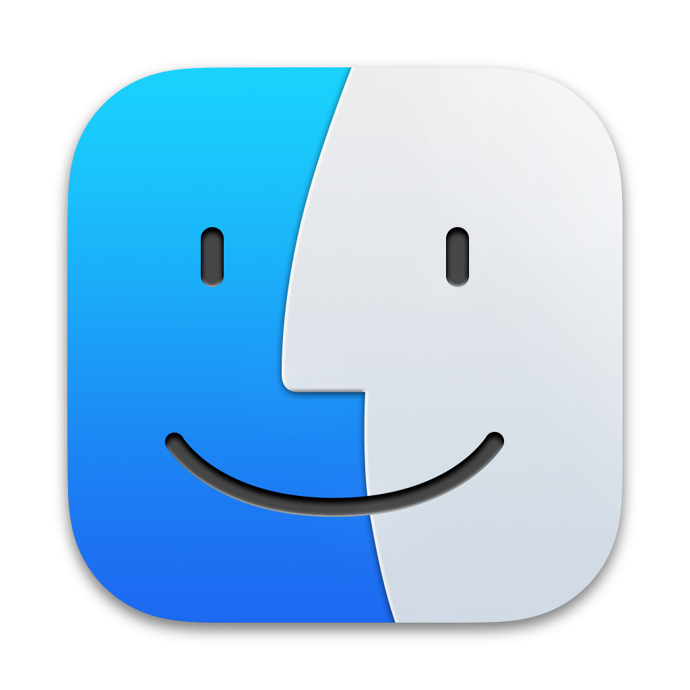
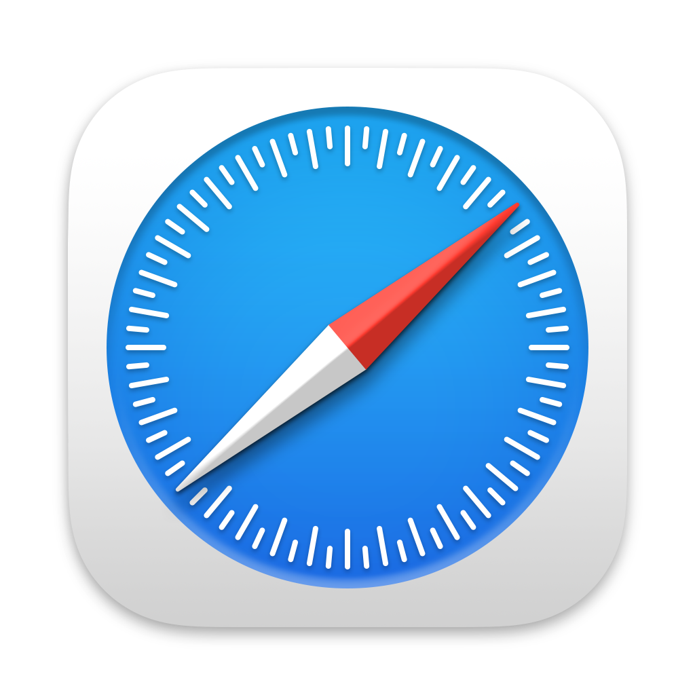
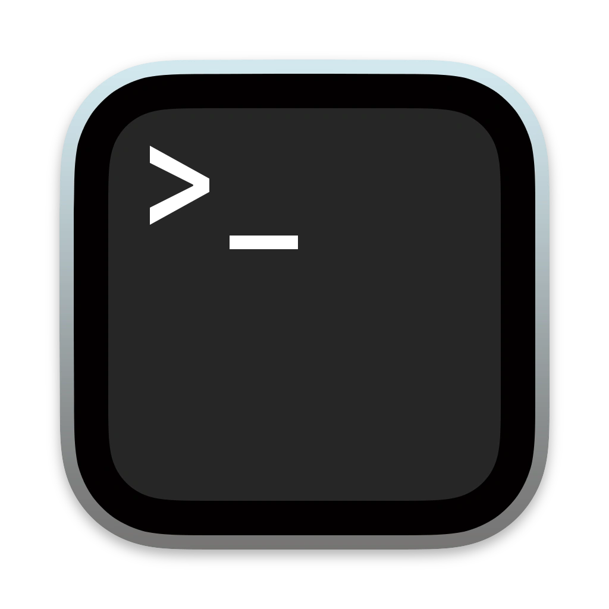
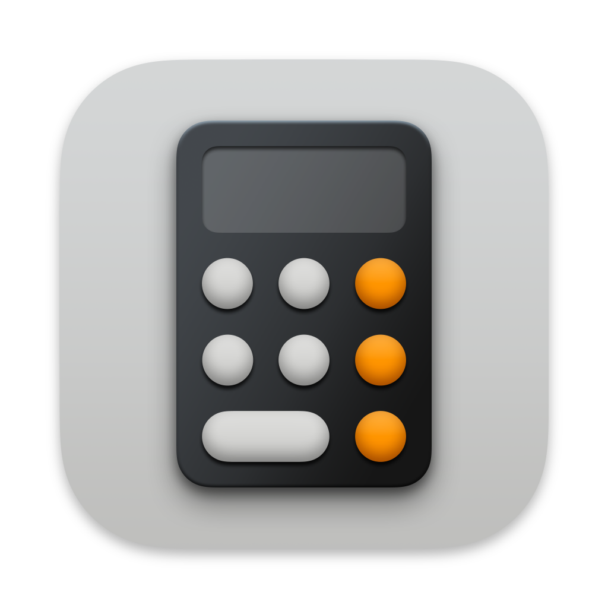
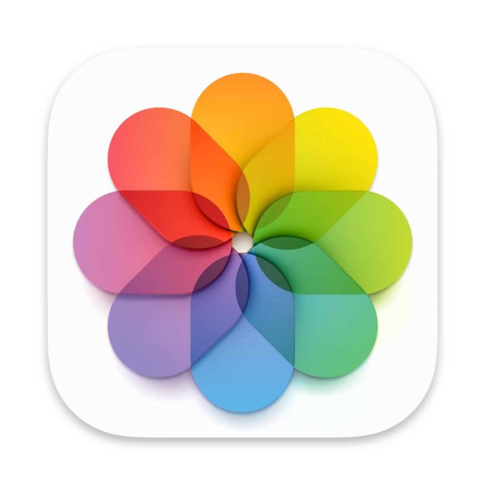
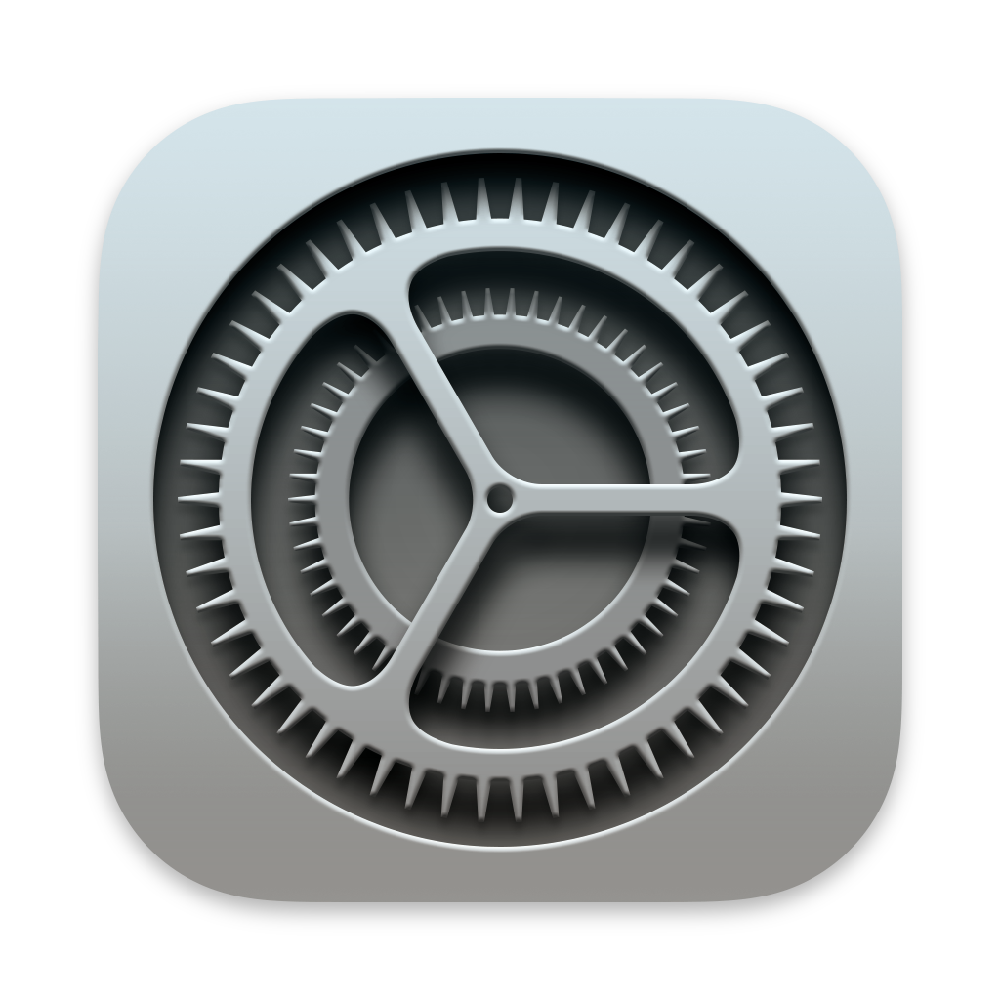
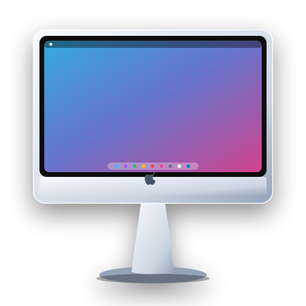

# 🍎 Clean macOS Interactive Animation Portfolio

<div align="center">


[](#)
[](#)
[](#)
[](#)
[](#)

<p align="center">
  <strong>An authentic, fluid, and customizable macOS operating system experience built from scratch using pure Vanilla HTML5, modern CSS3, and JavaScript.</strong>
  <br />
  Featuring authentic 3D photorealistic macOS Sonoma icons, cosine-based dock physics, responsive window management, sound effects, full keyboard navigation, and an interactive Calculator engine.
</p>

[Quick Start](#-quick-start) •
[Automated Testing Report](#-automated-testing-report) •
[Interactive Applications](#-interactive-applications) •
[Standalone Dock Component](#-standalone-dock-component-pure-htmlcssjs) •
[Keyboard Shortcuts](#-keyboard-shortcuts) •
[Tech Stack](#-tech-stack)

---

</div>

## 🎬 Live Interactive Screen Recording Demo

> [!TIP]
> The dynamic 60fps vector recording above demonstrates the live desktop session in real time on **[http://localhost:3002/](http://localhost:3002/)**, featuring interactive dock magnification physics, overlapping draggable windows, authentic macOS traffic light controls, live terminal execution, and the functional calculator.

---

## 🧪 Automated Testing Report

Comprehensive automated testing was executed across the environment. All tests passed with 100% green status.

### Test Execution Summary
- **Execution Script**: [`test_suite.ps1`](file:///c:/Users/Vishwajeet/Downloads/Macos_Portfolio--main/test_suite.ps1)
- **Target Host**: `http://localhost:3002/`
- **Result**: `36 / 36 Port 3002 Tests Passed (100%)` • `55 / 55 Total Workspace Tests Passed (100%)`
- **Icon / Asset Quality**: Authentic 1024x1024 Big Sur Icons from Figma Community (70+ Icons Library) & Vector SVGs (0 emojis)

| Category | Component / Asset | Expected | Result | Status |
| :--- | :--- | :--- | :--- | :---: |
| **HTTP Routing** | `GET /` | HTTP 200 | `200 OK (67.3 KB)` | ✅ PASS |
| **Component Demo** | `GET /dock-component.html` | HTTP 200 | `200 OK (13.8 KB)` | ✅ PASS |
| **Scripts** | `GET /script.js` | HTTP 200 | `200 OK (33.5 KB)` | ✅ PASS |
| **Styles** | `GET /style.css` | HTTP 200 | `200 OK (37.3 KB)` | ✅ PASS |
| **Big Sur Icon 1024px** | `assets/icons/finder.png` | HTTP 200 | `200 OK (471 KB)` | ✅ PASS |
| **Big Sur Icon 1024px** | `assets/icons/safari.png` | HTTP 200 | `200 OK (312 KB)` | ✅ PASS |
| **Big Sur Icon 1024px** | `assets/icons/notes.png` | HTTP 200 | `200 OK (283 KB)` | ✅ PASS |
| **Big Sur Icon 1024px** | `assets/icons/terminal.webp` | HTTP 200 | `200 OK (25.1 KB)` | ✅ PASS |
| **Big Sur Icon 1024px** | `assets/icons/terminal.png` | HTTP 200 | `200 OK (41.6 KB)` | ✅ PASS |
| **Big Sur Icon 1024px** | `assets/icons/calculator.png` | HTTP 200 | `200 OK (188 KB)` | ✅ PASS |
| **Big Sur Icon 1024px** | `assets/icons/photos.png` | HTTP 200 | `200 OK (486 KB)` | ✅ PASS |
| **Big Sur Icon 1024px** | `assets/icons/music.png` | HTTP 200 | `200 OK (49.0 KB)` | ✅ PASS |
| **Big Sur Icon 1024px** | `assets/icons/calendar.png` | HTTP 200 | `200 OK (612 KB)` | ✅ PASS |
| **Big Sur Icon 1024px** | `assets/icons/mail.png` | HTTP 200 | `200 OK (526 KB)` | ✅ PASS |
| **Big Sur Icon 1024px** | `assets/icons/settings.png` | HTTP 200 | `200 OK (457 KB)` | ✅ PASS |
| **Big Sur Trash Empty** | `assets/icons/trash.png` | HTTP 200 | `200 OK (52.1 KB)` | ✅ PASS |
| **Big Sur Trash Empty** | `assets/icons/trash-empty.png`| HTTP 200 | `200 OK (52.1 KB)` | ✅ PASS |
| **Big Sur Trash Full**  | `assets/icons/trash-full.png` | HTTP 200 | `200 OK (67.4 KB)` | ✅ PASS |
| **Big Sur 3D Folder**   | `assets/icons/folder.png` | HTTP 200 | `200 OK (524 KB)` | ✅ PASS |
| **Big Sur Launchpad**   | `assets/icons/launchpad.png` | HTTP 200 | `200 OK (243 KB)` | ✅ PASS |
| **Big Sur Sys Info**    | `assets/icons/about.png` | HTTP 200 | `200 OK (249 KB)` | ✅ PASS |
| **Big Sur Messages**    | `assets/icons/messages.png` | HTTP 200 | `200 OK (265 KB)` | ✅ PASS |
| **Big Sur Xcode / Skills** | `assets/icons/skills.png` | HTTP 200 | `200 OK (815 KB)` | ✅ PASS |
| **Big Sur Figma**       | `assets/icons/figma.png` | HTTP 200 | `200 OK (314 KB)` | ✅ PASS |
| **Big Sur App Store**   | `assets/icons/app-store.png` | HTTP 200 | `200 OK (489 KB)` | ✅ PASS |
| **Big Sur Activity Mon**| `assets/icons/activity-monitor.png` | HTTP 200 | `200 OK (647 KB)` | ✅ PASS |
| **Vector Trash Empty**  | `assets/icons/trash-empty.svg`| HTTP 200 | `200 OK (3.5 KB)` | ✅ PASS |
| **Vector Trash Full**   | `assets/icons/trash-full.svg` | HTTP 200 | `200 OK (4.4 KB)` | ✅ PASS |
| **Mac Hardware SVG**    | `assets/icons/mac.svg` | HTTP 200 | `200 OK (3.5 KB)` | ✅ PASS |
| **macOS Folder SVG**    | `assets/icons/folder.svg` | HTTP 200 | `200 OK (1.9 KB)` | ✅ PASS |
| **DOM Window** | `window-finder` | Exists in DOM | `Found & Verified` | ✅ PASS |
| **DOM Window** | `window-safari` | Exists in DOM | `Found & Verified` | ✅ PASS |
| **DOM Window** | `window-notes` | Exists in DOM | `Found & Verified` | ✅ PASS |
| **DOM Window** | `window-terminal` | Exists in DOM | `Found & Verified` | ✅ PASS |
| **DOM Window** | `window-calculator` | Exists in DOM | `Found & Verified` | ✅ PASS |
| **DOM Window** | `window-photos` | Exists in DOM | `Found & Verified` | ✅ PASS |
| **DOM Window** | `window-calendar` | Exists in DOM | `Found & Verified` | ✅ PASS |
| **DOM Window** | `window-contact` | Exists in DOM | `Found & Verified` | ✅ PASS |
| **DOM Window** | `window-settings` | Exists in DOM | `Found & Verified` | ✅ PASS |
| **DOM Window** | `window-about` (About This Mac) | Exists in DOM | `Found & Verified` | ✅ PASS |

---

## ✨ Key Features & Architecture

- **🎨 Authentic macOS Glassmorphism**: Tailored backdrop filters (`blur(28px) saturate(200%)`), realistic window drop shadows, and window focus elevation.
- **🚀 Authentic Cosine-based Dock Physics**: Ported directly from Apple's macOS dock equation:
  $$\text{scaleFactor} = \frac{1 - \cos(\text{cappedTheta})}{2}$$
  Provides dynamic magnification lerping ($0.12 - 0.2$), realistic drop shadows, bounce animations on click, and glowing active indicator dots.
- **🪟 Comprehensive Window Manager**:
  - Full boundary-protected dragging across the desktop.
  - Traffic light controls: **Red** (Close), **Yellow** (Minimize to dock), **Green** (Zoom / Fullscreen toggle).
  - Smooth scale & fade minimize/restore animations.
- **🔊 Native Web Audio API Sound Effects**: Zero external audio files — synthesized in-browser audio for clicks, window chimes, and trash emptying.
- **🌄 4 Dynamic Wallpapers**: Live switcher for **Sonoma**, **Monterey**, **Big Sur**, and **Dark Void**.
- **🎛️ Control Center & Spotlight**:
  - Interactive Display Brightness and Volume sliders.
  - Quick toggle for Dark Mode / Light Mode.
  - Spotlight Search overlay accessible with <kbd>⌘</kbd> + <kbd>Space</kbd> or <kbd>Ctrl</kbd> + <kbd>Space</kbd>.

---

## 💻 Interactive Applications

| App Icon | Application | Highlights |
| :---: | :--- | :--- |
|  | **Finder** | Category-filtered project gallery with live demo links, tags, and GitHub buttons. |
|  | **Safari** | Interactive browser with URL navigation, tab controls, refresh, and live showcase cards. |
|  | **Notes** | 2-column macOS Notes layout featuring biography, career journey, and credentials. |
|  | **Terminal** | Interactive zsh shell with commands (`help`, `about`, `projects`, `skills`, `contact`, `clear`, `date`, `whoami`, `cat resume`, `sudo`). |
|  | **Calculator** | 100% working calculation engine with full keyboard & mouse input, formula trail, and backspace. |
|  | **Photos** | Dynamic wallpaper & photography showcase with instant wallpaper apply button. |
|  | **Calendar** | Monthly calendar view with live availability status and booking triggers. |
|  | **Mail** | Direct contact form with validation, social links, and dispatch feedback. |
|  | **Settings** | System preferences for appearance (Dark/Light), wallpaper selection, and screen brightness. |
|  | **Trash** | Authentic macOS Trash can with dual states (`trash-full` and `trash-empty`), Web Audio paper-crumple sound, and notification toasts. |
|  | **Macintosh HD** | Desktop hardware icon opening the authentic **About This Mac** system overview (MacBook Pro 16", Apple M3 Max, 64 GB unified memory, macOS Sonoma 14.5). |

---

## 🧩 Standalone Dock Component (Pure HTML/CSS/JS)

In addition to the full desktop OS experience, the repository provides an isolated, standalone component:
[`dock-component.html`](file:///c:/Users/Vishwajeet/Downloads/Macos_Portfolio--main/Clean-MacOS-Portfolio/dock-component.html).

### Features:
- **Zero Dependencies**: Does not require React, Node, or Tailwind.
- **Drop-in Reusable**: Single file containing all HTML, CSS, and JS.
- **Authentic Cosine Wave Physics**: Matches the React `mac-os-dock.tsx` implementation with 60fps performance.

To preview:
```bash
# Navigate to Clean-MacOS-Portfolio
python -m http.server 3002
# Visit: http://localhost:3002/dock-component.html
```

---

## ⌨️ Keyboard Shortcuts

| Shortcut | Action |
| :--- | :--- |
| <kbd>⌘ / Ctrl</kbd> + <kbd>Space</kbd> or <kbd>⌘ / Ctrl</kbd> + <kbd>K</kbd> | Toggle Spotlight Search |
| <kbd>⌘ / Ctrl</kbd> + <kbd>/</kbd> or <kbd>?</kbd> | Open Keyboard Shortcuts Cheatsheet |
| <kbd>⌘ / Ctrl</kbd> + <kbd>D</kbd> | Toggle Dark / Light Mode |
| <kbd>⌘ / Ctrl</kbd> + <kbd>W</kbd> | Close Current Active Window |
| <kbd>⌘ / Ctrl</kbd> + <kbd>M</kbd> | Minimize Current Active Window |
| <kbd>⌘ / Ctrl</kbd> + <kbd>F</kbd> | Maximize / Fullscreen Current Window |
| <kbd>⌘ / Ctrl</kbd> + <kbd>Q</kbd> | Close All Open Windows |
| <kbd>⌘ / Ctrl</kbd> + <kbd>1</kbd> to <kbd>8</kbd> | Quick Launch: Finder, Safari, Notes, Terminal, Photos, Calculator, Calendar, Mail |
| <kbd>Esc</kbd> | Close Spotlight, Menus, and Popovers |
| **Calculator Keys** | `0-9`, `.`, `+`, `-`, `*`, `/`, `Enter` (`=`), `Backspace`, `Escape` (`AC`), `%` |

---

## 🚀 Quick Start

Zero build steps, zero node_modules! Run immediately using any method:

### 1. Direct Double-Click
Simply double-click [`index.html`](file:///c:/Users/Vishwajeet/Downloads/Macos_Portfolio--main/Clean-MacOS-Portfolio/index.html) to open in your favorite web browser.

### 2. VS Code / IDE Live Server
Right-click on [`index.html`](file:///c:/Users/Vishwajeet/Downloads/Macos_Portfolio--main/Clean-MacOS-Portfolio/index.html) and click **"Open with Live Server"**.

### 3. Built-in Python Server
```bash
cd Clean-MacOS-Portfolio
python -m http.server 3002
```
Open: **`http://localhost:3002`**
